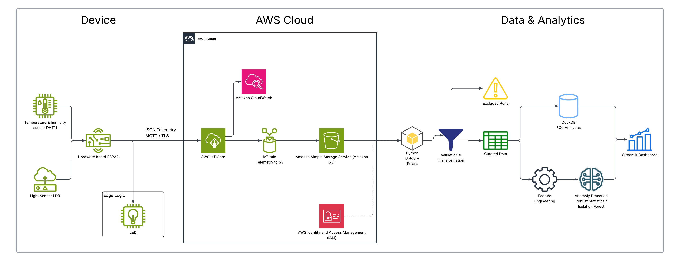
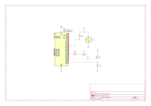

# OfficePulse

OfficePulse es una plataforma IoT de analítica ambiental que recorre el ciclo completo de un dato real: captura física, decisión local en un ESP32, transporte seguro a AWS, almacenamiento histórico, procesamiento de datos, detección de anomalías y visualización.

El repositorio representa un MVP terminado y contiene un dataset de ejemplo obtenido de hardware real. Los resultados numéricos documentados corresponden al snapshot incluido actualmente; al descargar nuevas sesiones y reconstruir el pipeline, esos valores cambiarán.

## Caso de uso

Una oficina, aula, laboratorio o espacio de trabajo necesita registrar temperatura, humedad e iluminación para conservar un histórico, comprobar la calidad de las mediciones y analizar cambios ambientales. OfficePulse instrumenta ese escenario con un nodo físico y mantiene trazabilidad desde cada lectura hasta el dashboard.

El LED demuestra una decisión de control en el borde; no controla HVAC ni ventilación.

## Qué demuestra el proyecto

Sensores físicos -> ESP32 y lógica edge -> JSON -> MQTT/TLS
-> AWS IoT Core -> IoT Rule -> Amazon S3 RAW
-> boto3 -> validación con Polars -> CURATED / QUARANTINE
-> Parquet -> DuckDB / SQL -> feature engineering
-> detección de anomalías -> Streamlit

El flujo integra firmware, seguridad IoT, servicios AWS, data engineering, controles de calidad, analítica y una aplicación local sin introducir infraestructura que el MVP no necesita.

## Arquitectura



La solución se divide en tres capas:

- **Device:** DHT11 y LDR conectados a un ESP32; adquisición, trazabilidad y control local del LED.
- **AWS Cloud:** autenticación X.509, recepción MQTT/TLS en AWS IoT Core, enriquecimiento mediante una IoT Rule, almacenamiento RAW en S3 y observabilidad en CloudWatch.
- **Data & Analytics:** descarga incremental, validación, Parquet, consultas con DuckDB, features temporales, detección de anomalías y dashboard Streamlit.

## Hardware

- ESP32 DevKit V1 con módulo ESP32-WROOM-32.
- Sensor DHT11 para temperatura y humedad.
- Sensor LDR para iluminación.
- LED como actuador.
- Dos resistencias de 10 kΩ.
- Una resistencia de 330 Ω.
- Protoboard y conexiones.

Los valores usados por el prototipo son `DHT_PIN = 15`, `LDR_PIN = 34`, `LED_PIN = 23` y `DARK_THRESHOLD = 200`. Pueden ajustarse en `src/main.cpp` para otro montaje, respetando las capacidades eléctricas del hardware utilizado.

## Procesamiento en el borde

El ESP32 aplica esta regla sin depender de AWS para el sensor LDR:

```text
light_raw < 200  -> light_state = "dark"   -> LED ON
light_raw >= 200 -> light_state = "bright" -> LED OFF
```

De forma predeterminada, el firmware `0.3.0` publica una lectura por minuto con device/client ID `office-node-01` en `officepulse/office-node-01/telemetry`. Un despliegue propio puede cambiar `DEVICE_ID`, `AWS_IOT_CLIENT_ID`, `AWS_IOT_TOPIC` y `READING_INTERVAL_MS` en `src/main.cpp`; el certificado, la IoT Policy, la IoT Rule y el prefijo S3 deben permitir los mismos identificadores.

## Circuito electrónico



El esquema representa las conexiones utilizadas por OfficePulse. El ESP32 DevKit V1, basado en el módulo ESP32-WROOM-32, trabaja con lógica de 3.3 V. El pin DATA del DHT11 se conecta a GPIO15 y utiliza una resistencia pull-up de 10 kΩ. El LDR se conecta a GPIO34 mediante un divisor de voltaje con una resistencia de 10 kΩ. El LED se controla desde GPIO23 a través de la resistencia limitadora de 330 Ω mostrada en el esquema.

## Telemetría

Cada mensaje identifica el dispositivo, la sesión experimental y el arranque físico. Los valores siguientes son ilustrativos y deben sustituirse por los identificadores y mediciones de cada despliegue:

```json
{
  "device_id": "office-node-01",
  "session_id": "baseline_01",
  "boot_id": 1234567890,
  "sequence_number": 12,
  "device_timestamp_ms": 1787302000000,
  "uptime_ms": 720000,
  "dht_valid": true,
  "temperature_c": 30.4,
  "humidity_pct": 39.0,
  "light_raw": 356,
  "light_state": "bright",
  "led_active": false,
  "wifi_rssi": -61,
  "firmware_version": "0.3.0"
}
```

`boot_id`, `sequence_number`, `device_timestamp_ms` y `uptime_ms` permiten detectar reinicios, gaps y problemas de orden. La ingesta incorpora `aws_ingest_ts` y `mqtt_topic`, usados para medir latencia y conservar el origen del mensaje.

## AWS y seguridad

OfficePulse utiliza exclusivamente:

- **AWS IoT Core** para la conexión del dispositivo y la recepción MQTT.
- **AWS IoT Rules Engine** para enrutar y enriquecer la telemetría.
- **Amazon S3** como capa RAW inmutable.
- **AWS IAM** para el acceso local con AWS CLI y boto3.
- **Amazon CloudWatch** para observabilidad básica del flujo IoT.
- **AWS Budgets** para control de gasto.

El dispositivo se autentica mediante MQTT sobre TLS, certificado X.509 y una AWS IoT Policy. El pipeline usa la cadena de credenciales de boto3; no contiene access keys en el código. Los archivos locales con Wi-Fi, endpoint, certificado y clave privada están excluidos de Git y cuentan con plantillas publicables en `include/*.example.h`.

Los recursos AWS no se crean automáticamente desde este repositorio. Para usar una cuenta propia es necesario preparar una vez:

1. Un Thing de AWS IoT, un certificado activo y una IoT Policy con permisos limitados al client ID y al topic elegidos.
2. Un bucket S3 para conservar los mensajes RAW.
3. Una IoT Rule que reciba la telemetría, añada los campos requeridos por el pipeline y escriba cada mensaje como un objeto independiente en S3.
4. Un rol que AWS IoT pueda asumir con permiso `s3:PutObject` sobre el prefijo de destino.
5. Una identidad local con `s3:ListBucket` y `s3:GetObject` para ejecutar `download_raw.py`.

Para el topic predeterminado, una configuración equivalente de la IoT Rule es:

```sql
SELECT
    *,
    timestamp() AS aws_ingest_ts,
    topic() AS mqtt_topic
FROM 'officepulse/+/telemetry'
```

La acción S3 puede usar una clave como `raw/${topic(2)}/${timestamp()}.json`. Si se cambia el topic o la estructura de la clave, también debe actualizarse `PREFIX` en `data-pipeline/src/download_raw.py`. Los nombres de bucket, cuenta, usuario, perfil, Thing, certificado y rol pertenecen al entorno de cada usuario y no deben copiarse literalmente desde otro despliegue.

Referencias: [crear una IoT Rule](https://docs.aws.amazon.com/iot/latest/developerguide/iot-create-rule.html), [funciones SQL de AWS IoT](https://docs.aws.amazon.com/iot/latest/developerguide/iot-sql-functions.html) y [acción S3 de una IoT Rule](https://docs.aws.amazon.com/iot/latest/developerguide/s3-rule-action.html).

## Data Engineering

El pipeline conserva la capa RAW y construye datasets analíticos por etapas:

```text
JSON RAW -> schema validation -> transformación
-> selección del boot principal por sesión
-> CURATED + QUARANTINE -> Parquet -> DuckDB / SQL
```

Para cada `session_id`, el `boot_id` con más registros se considera la ejecución principal. Los registros de boots secundarios son técnicamente válidos, pero se guardan en QUARANTINE con la razón `non_primary_boot_for_session`; no se borran ni se presentan como datos corruptos. Por ello, las cantidades dependen de las capturas disponibles en `data/raw`.

## Calidad de datos del snapshot incluido

Estos valores describen los archivos incluidos actualmente y no son constantes del pipeline. Se recalculan al ejecutar `build_dataset.py`.

| Control | Resultado |
|---|---:|
| JSON RAW | 354 |
| JSON válidos / corruptos | 354 / 0 |
| CURATED / QUARANTINE | 316 / 38 |
| Duplicados | 0 |
| Sequence gaps | 0 |
| Mensajes faltantes estimados | 0 |
| Lecturas DHT inválidas | 0 |
| Humedad inválida | 0 |
| Iluminación inválida | 0 |
| Errores de `light_state` | 0 |
| Errores de lógica del LED | 0 |

Conservar QUARANTINE separa la serie analítica sin sacrificar trazabilidad, auditabilidad ni integridad del RAW.

## Sesiones del snapshot incluido

| Sesión | Propósito | Registros CURATED |
|---|---|---:|
| `baseline_01` | Comportamiento normal para entrenamiento | 47 |
| `baseline_02` | Comportamiento normal independiente para validación | 50 |
| `light_transition_01` | Cambios controlados de iluminación | 93 |
| `temperature_transition_01` | Perturbación térmica controlada | 126 |

Los baselines se capturaron aproximadamente cada minuto y las pruebas controladas aproximadamente cada 10 segundos. Para evitar que la frecuencia de muestreo sesgara el análisis, todas las sesiones se agregaron a ventanas de un minuto. El snapshot actual, sin incluir la captura demostrativa pendiente, produce 135 observaciones resampleadas y 131 observaciones ML-ready.

## Demostración paso a paso: `baseline_03`

`baseline_03` está reservada para la demostración completa del proyecto en video y para la documentación final. Esta sesión mostrará el flujo de principio a fin: configuración de `SESSION_ID` en el firmware, captura con el ESP32, envío mediante AWS IoT Core, almacenamiento en S3, descarga del RAW, construcción del dataset, generación de features, detección de anomalías y visualización en el dashboard.

Las cantidades de registros y las métricas de `baseline_03` no se fijan en este README antes de realizar la captura definitiva. Se obtendrán al seguir la sección **Cómo ejecutar el proyecto** y se documentarán después de completar y validar la demostración. Así, los resultados publicados corresponderán exactamente a la ejecución mostrada en el video.

## Feature engineering

El análisis modela dinámica temporal mediante deltas, tasas por minuto y magnitudes absolutas de cambio para temperatura, humedad e iluminación. Los detectores usan principalmente:

- `temperature_change_magnitude`
- `humidity_change_magnitude`
- `light_change_magnitude`

`light_state` y `led_active` no se usan como entradas porque ya codifican la decisión edge y producirían leakage conceptual. `elapsed_minutes`, `samples_in_minute`, `led_active_ratio` y `dark_ratio` se conservan como contexto analítico.

## Detección de anomalías

El prototipo funcional compara tres salidas:

1. Detector estadístico robusto basado en mediana, MAD, fallback a desviación estándar cuando `MAD = 0` y umbral `3.5`.
2. Isolation Forest entrenado solo con las 46 observaciones ML-ready de `baseline_01` (`n_estimators = 300`, `contamination = "auto"`, `random_state = 42`). El código aplica como umbral el percentil 95 de los scores de entrenamiento.
3. Consenso, activado solo cuando ambos detectores marcan la misma observación.

Resultados obtenidos con el snapshot incluido:

| Grupo de evaluación | Observaciones ML-ready | Flag rate de consenso |
|---|---:|---:|
| Normal de entrenamiento (`baseline_01`) | 46 | 2.17 % |
| Normal de validación (`baseline_02`) | 49 | 2.04 % |
| Prueba de iluminación | 15 | 53.33 % |
| Prueba de temperatura | 21 | 4.76 % |

Estos valores son **flag rates**, no accuracy, precision ni recall: no existe ground truth minuto a minuto. Cambian cuando se agregan nuevas sesiones `baseline_N` al grupo de validación. La transición de luz se detecta claramente; la perturbación térmica genera menos flags porque su cambio es gradual. El modelo no se presenta como production-ready ni como evidencia de generalización.

## Dashboard

El dashboard local consume los Parquet procesados con Streamlit, Plotly y Polars; no usa pandas.

- **Overview:** temperatura, humedad, luz, RSSI Wi-Fi, latencia de AWS, estado del LED y tendencias.
- **Historical Analysis:** comparación de sesiones, históricos y calidad de datos.
- **Anomaly Detection:** detectores estadístico e Isolation Forest, consenso, scores, registros marcados y filtros por sesión.

No es un dashboard productivo en tiempo real ni una aplicación desplegada públicamente.

## Observabilidad

CloudWatch aporta visibilidad básica de conexión, publicación y ejecución de reglas mediante `PublishIn.Success`, `Connect.Success`, `RulesExecuted` y las métricas de éxito o fallo de la acción S3.

## Estimación ilustrativa de costos

Como referencia del MVP, se modeló en AWS Pricing Calculator un ESP32 conectado 24/7, un mensaje por minuto durante 30 días y la región `us-east-1`:

- 43,200 mensajes, RulesTriggered y ActionsExecuted al mes.
- Aproximadamente 43,200 operaciones S3 PUT y 43,200 S3 GET en el escenario calculado.
- Aproximadamente **USD 3.29/mes** a precio de lista: IoT Core ~USD 0.06, S3 ~USD 0.23 y dashboard de CloudWatch ~USD 3.00.

Esta cifra no constituye una cotización ni un costo garantizado para otros usuarios. El importe efectivo depende de la región elegida, volumen de mensajes, almacenamiento, consultas, retención de métricas, impuestos, Free Tier aplicable y precios vigentes. Cada despliegue debe generar su propia estimación antes de crear recursos.

## Stack tecnológico

| Área | Tecnologías |
|---|---|
| Firmware / Edge | C++, Arduino, PlatformIO, DHT, ArduinoJson, WiFiClientSecure, PubSubClient, NTP |
| Cloud | AWS IoT Core, IoT Rules Engine, S3, IAM, CloudWatch, Budgets |
| Data | Python, boto3, Polars, PyArrow, Parquet |
| Analytics / ML | DuckDB, SQL, NumPy, scikit-learn, Matplotlib |
| Visualización | Streamlit, Plotly |

## Estructura del repositorio

```text
officepulse/
|-- src/                         # firmware ESP32
|-- include/                     # plantillas publicables de configuración IoT
|-- data-pipeline/
|   |-- src/                     # ingesta, validación, EDA, features y ML
|   |-- sql/                     # análisis DuckDB
|   |-- dashboard/               # aplicación Streamlit
|   `-- data/                    # RAW, CURATED, QUARANTINE y resultados
|-- Architecture.png
|-- Circuit.svg
|-- platformio.ini
`-- README.md
```

## Cómo ejecutar el proyecto

Hay dos formas de utilizar el repositorio:

- **Reproducir el análisis incluido:** solo requiere Python y los archivos de `data-pipeline/data/raw`; no necesita hardware, cuenta AWS ni credenciales.
- **Capturar datos propios:** requiere el hardware descrito, PlatformIO, una red Wi-Fi, recursos propios en AWS IoT/S3 y AWS CLI v2 para descargar los mensajes.

Los comandos siguientes están escritos para PowerShell en Windows. En Linux o macOS deben adaptarse las rutas del ejecutable del entorno virtual.

### 1. Preparar y ejecutar el firmware

Se requiere VSCode con la extensión PlatformIO y un dispositivo configurado en AWS IoT.
Desde la raíz del repositorio:

1. Copiar `include/secrets.example.h` como `include/secrets.h` y completar las credenciales Wi-Fi y el endpoint del entorno AWS IoT propio.
2. Copiar `include/aws_certs.example.h` como `include/aws_certs.h` y completar la CA, el certificado y la clave privada emitidos para el dispositivo propio.
3. Durante la configuración inicial, revisar en `src/main.cpp` que `DEVICE_ID`, `AWS_IOT_CLIENT_ID` y `AWS_IOT_TOPIC` coincidan con el Thing, certificado, policy y rule creados en AWS.
4. Ajustar `SESSION_ID` en `src/main.cpp` antes de cada captura. Para una sesión normal debe usarse el formato `baseline_N`, por ejemplo:

   ```cpp
   constexpr char SESSION_ID[] = "baseline_04";
   ```

5. Compilar, cargar el firmware y abrir el monitor serial:

   ```powershell
   pio run
   pio run --target upload
   pio device monitor
   ```

6. Mantener el dispositivo encendido durante el periodo de captura. La telemetría se publica en AWS IoT Core y se almacena como JSON RAW en Amazon S3.

Las sesiones `baseline_N` se incorporan automáticamente al pipeline. `baseline_01`
permanece como conjunto de entrenamiento y cualquier otro `baseline_N` se clasifica
como validación normal. No es necesario modificar los archivos Python al capturar
`baseline_03`, `baseline_04` o sesiones posteriores.

### 2. Preparar el entorno local

Desde `data-pipeline/`, crear el entorno virtual e instalar las dependencias:

```powershell
python -m venv .venv
.\.venv\Scripts\python.exe -m pip install -r requirements.txt
```

`requirements.txt` instala también AWS CRT mediante `boto3[crt]`, necesario para que Boto3 pueda utilizar las credenciales temporales generadas por `aws login`. La creación del entorno y la instalación de dependencias solo son necesarias la primera vez o cuando cambie `requirements.txt`.

### 3. Configurar el acceso a AWS

Este paso solo es necesario para descargar capturas nuevas desde un bucket S3. Para reproducir los datos RAW incluidos en el repositorio puede omitirse por completo.

Antes de continuar:

1. Instalar [AWS CLI v2](https://docs.aws.amazon.com/cli/latest/userguide/getting-started-install.html) por separado. Es una aplicación del sistema y no forma parte de `requirements.txt`. Verificar la instalación con:

   ```powershell
   aws --version
   ```

   La salida debe comenzar con `aws-cli/2`.

2. Contar con acceso al bucket que contiene la telemetría.
3. Configurar `BUCKET_NAME`, `PREFIX` y la región en `src/download_raw.py` para que correspondan al entorno AWS propio.
4. Utilizar una identidad con permisos para listar el bucket y descargar sus objetos, como mínimo `s3:ListBucket` y `s3:GetObject`.

La configuración del bucket, el perfil y las credenciales se realiza una sola vez por entorno. Después de configurarla, cada nueva captura `baseline_N` solo requiere cambiar `SESSION_ID`, cargar el firmware y repetir la descarga y el procesamiento.

El nombre del perfil es local y puede elegirse libremente. En los siguientes ejemplos se utiliza `officepulse-local`:

```powershell
$profileName = "officepulse-local"
```

#### Opción A: inicio de sesión desde el navegador

Esta opción utiliza las credenciales de acceso a la consola de un usuario IAM y genera credenciales temporales. No requiere crear una access key permanente.

```powershell
aws login --profile $profileName
$env:AWS_PROFILE = $profileName
aws sts get-caller-identity --profile $profileName
```

El navegador solicitará el Account ID o alias de la cuenta, nombre del usuario IAM, contraseña y MFA si está habilitado. El soporte CRT que permite a Boto3 utilizar esta sesión ya se instala mediante `requirements.txt`.

Referencia: [inicio de sesión local con `aws login`](https://docs.aws.amazon.com/cli/latest/userguide/cli-configure-sign-in.html).

Si la sesión expira, ejecutar nuevamente:

```powershell
aws login --profile $profileName
```

#### Opción B: access key de un usuario IAM

Esta opción configura un perfil mediante una Access Key ID y una Secret Access Key:

```powershell
aws configure --profile $profileName
$env:AWS_PROFILE = $profileName
aws sts get-caller-identity --profile $profileName
```

`aws configure` solicitará la Access Key ID, Secret Access Key, región predeterminada y formato de salida. Las credenciales deben permanecer fuera del repositorio y nunca deben escribirse en el código ni agregarse a Git.

Referencia: [autenticación de AWS CLI con credenciales de usuario IAM](https://docs.aws.amazon.com/cli/latest/userguide/cli-authentication-user.html).

En ambas opciones, `get-caller-identity` permite verificar qué identidad se utilizará antes de acceder a S3. La variable `AWS_PROFILE` debe establecerse nuevamente al abrir una terminal de PowerShell nueva.

### 4. Descargar la nueva captura

Después de autenticar el perfil seleccionado, desde `data-pipeline/`:

```powershell
.\.venv\Scripts\python.exe src\download_raw.py
```

`download_raw.py` descarga los JSON nuevos desde S3 a `data/raw` y omite los archivos que ya existen localmente.

### 5. Construir y analizar el dataset

Ejecutar los scripts en este orden desde `data-pipeline/`:

```powershell
.\.venv\Scripts\python.exe src\build_dataset.py
.\.venv\Scripts\python.exe src\eda.py
.\.venv\Scripts\python.exe sql\analyze_baseline.py
.\.venv\Scripts\python.exe src\feature_engineering.py
.\.venv\Scripts\python.exe src\anomaly_detection.py
```

Cada etapa realiza lo siguiente:

1. `build_dataset.py` valida los JSON, reconoce automáticamente todas las sesiones `baseline_N`, selecciona la ejecución principal y genera `officepulse_all.parquet` y un Parquet por sesión.
2. `eda.py` genera estadísticas y gráficas para todas las sesiones encontradas.
3. `analyze_baseline.py` selecciona automáticamente el `baseline_N` con el número más alto y ejecuta el análisis descriptivo en DuckDB.
4. `feature_engineering.py` remuestrea las sesiones, crea las variables temporales y asigna los grupos de entrenamiento o validación.
5. `anomaly_detection.py` entrena con `baseline_01`, evalúa las sesiones de validación y las pruebas controladas, y guarda los scores y predicciones.

### 6. Abrir el dashboard

Después de generar los datasets y resultados del modelo:

```powershell
.\.venv\Scripts\python.exe -m streamlit run dashboard\app.py
```

El dashboard descubre automáticamente las sesiones disponibles y muestra nombres como “Referencia 03” o “Baseline 03”, según el idioma seleccionado.

## Limitaciones

- El entrenamiento normal contiene 46 observaciones ML-ready y cubre pocas sesiones controladas.
- No existe ground truth minuto a minuto para calcular métricas supervisadas.
- El DHT11 es adecuado para el MVP, no un sensor industrial.
- El dashboard trabaja localmente sobre Parquet procesado y no representa streaming en tiempo real.
- La configuración de recursos AWS no está versionada como infraestructura como código; el repositorio contiene firmware, pipeline, datos y diagrama.
- La detección de anomalías es un prototipo funcional sobre este dataset, no un modelo productivo.
